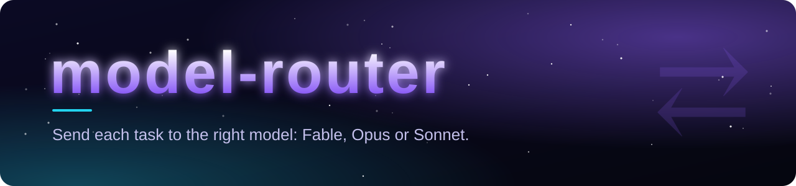

<!-- spiced -->
<p align="center">
  
</p>

<p align="center">
  
  
  <a href="https://github.com/Vortexyyy/model-router-skill/stargazers"></a>
</p>

<h3 align="center">A Claude Code skill that picks the right model for every task by difficulty, and guards your Fable usage.</h3>

<p align="center"><b>⭐ Like it? <a href="https://github.com/Vortexyyy/model-router-skill/stargazers">Drop a star</a>. It's free, takes a second, and helps others find it. ⭐</b></p>

---

A [Claude Code](https://claude.com/claude-code) skill that picks which model should handle a task, based on difficulty, whenever work is being delegated to a subagent.

| Tier | Model | `Agent` `model` value |
| --- | --- | --- |
| Very hard | Fable 5.2 (5.1 as fallback where selectable) | `fable` |
| Hard / medium | Opus 5.5 | `opus` |
| Easy / light | Sonnet | `sonnet` |

## What it does

- Classifies a task with a short rubric built on observable signals: files touched, ambiguity, cross-cutting reasoning, risk, and context size.
- Maps the tier to a model and delegates with the `Agent` tool.
- Rounds **up** on a boundary when a wrong answer would be costly.
- Reports which model handled which part, and flags any substitution.

## Fable usage guard

Fable is skipped once usage reaches a cutoff (`FABLE_USAGE_CUTOFF = 45` percent, triggered at `>=`). Two figures are read with the Claude Code desktop app's `get_usage` tool: the account's rolling 5-hour limit and Fable's weekly limit. If **either** is at or above the cutoff, very-hard tasks fall back to Opus, then Sonnet. Fable resumes automatically once both drop below the cutoff. If usage can't be read (for example outside the desktop app), Fable stays allowed and the routing note says "usage unknown". The cutoff constant and a table of check scenarios live in `SKILL.md`.

## Install

Skills live in `~/.claude/skills/<name>/SKILL.md`.

```bash
git clone https://github.com/Vortexyyy/model-router-skill ~/.claude/skills/model-router
```

Start a new Claude Code session. The skill triggers when a task is being delegated or a model has to be chosen, and can also be called as `/model-router`.

## Model identifier notes

- The `Agent` tool accepts only the aliases `sonnet`, `opus`, `haiku` and `fable`, which resolve to the **latest** model of each family. Older versions such as Sonnet 4.6 or Fable 5.1 cannot be pinned through it.
- If you need a specific version, pass a full model ID where your host allows it (for example `claude-sonnet-4-6` or `claude-fable-5-1`), and edit the mapping table in `SKILL.md`.
- Model names and aliases change over time. Check them against your own environment before relying on them.

## Customize

Edit `SKILL.md`: the rubric, the tier-to-model table and the boundary rule are plain Markdown.

## License

MIT


## 💜 Support

- ⭐ **[Star this repo](https://github.com/Vortexyyy/model-router-skill/stargazers)** so more people can find it.
- 🐛 **[Open an issue](https://github.com/Vortexyyy/model-router-skill/issues)** for bugs or ideas.
- 📣 Share it with a friend.

<p align="center">
  <a href="https://github.com/Vortexyyy/model-router-skill/stargazers"></a>
</p>
